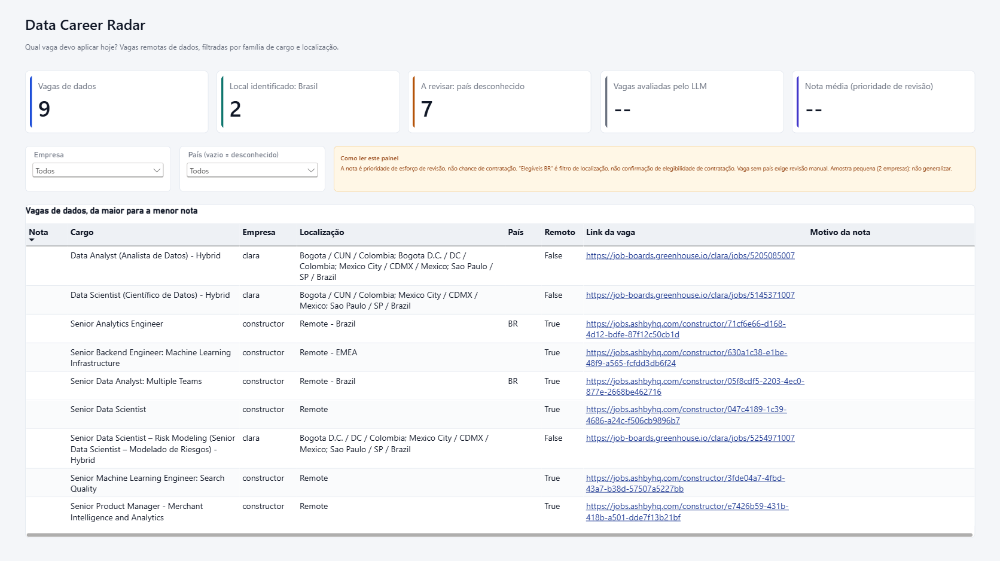
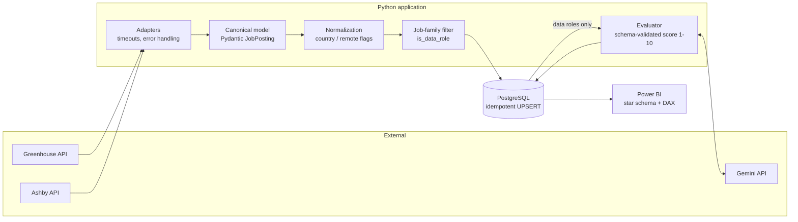

# Data Career Radar

> An end-to-end data pipeline that finds remote data roles a Brazil-based candidate can actually apply to, then ranks them in a Power BI dashboard so the answer to "which job do I apply to today?" takes seconds instead of hours.



*Power BI report built on the PostgreSQL star schema this pipeline fills. Data comes from two public company job boards; see [Current results and limits](#current-results-and-limits).*

## Why this exists

"Remote" on a job board often means "remote, US only" or "remote, EMEA only". Finding a role you are truly eligible for means opening each posting and reading the fine print. This project removes that manual step with code instead of a spreadsheet:

1. **Extract** postings straight from company applicant-tracking APIs, no scraping of authenticated pages.
2. **Normalize** messy location strings into explicit, queryable fields.
3. **Filter** to the data job family before spending money on an LLM.
4. **Score** the remaining postings against a candidate profile with a schema-validated LLM call.
5. **Visualize** the result for a decision, not for decoration.

Time saved has **not been measured yet**; no ROI figure is claimed.

## Where the data comes from

| Source | Endpoint | Used for |
|---|---|---|
| Greenhouse Job Board API | `boards-api.greenhouse.io/v1/boards/{board}/jobs` | Postings of a company board (currently `clara`) |
| Ashby Posting API | `api.ashbyhq.com/posting-api/job-board/{board}` | Postings of a company board (currently `constructor`) |
| Google Gemini API | `gemini-2.5-flash` by default | Optional scoring step (`evaluate`), needs `GEMINI_API_KEY` |

Greenhouse and Ashby are public, unauthenticated job-board endpoints that companies publish for their own listings. Add a board by passing its slug; add a provider by writing one adapter.

## Architecture



Power BI model: `fato_vagas` (one row per posting) joined to `dim_empresa` and `dim_calendario`, all one-to-many with single-direction filters. Seven DAX measures live in a `_Medidas` table. The full build recipe, with the SQL used to reconcile every measure against the database, is in [`BI/especificacao_modelo.md`](BI/especificacao_modelo.md).

## Engineering decisions worth discussing

1. **Adapter pattern.** Each provider has a different payload (`jobTitle` vs `title`). Adapters map them into one Pydantic `JobPosting`, so a new provider touches neither storage nor normalization.
2. **Idempotent ingestion.** `UNIQUE(source, board_slug, external_id)` plus PostgreSQL `ON CONFLICT DO UPDATE`: reruns insert new roles and refresh existing ones, never duplicate.
3. **Deterministic normalization before any LLM.** Regex and rules turn strings like `"São Paulo / SP / Brazil"` into `country_code` and `is_remote`. Anything unclear stays `NULL`.
4. **`NULL` is information, not zero.** A blank country means "unknown, needs review", never "outside Brazil". An unevaluated posting has no score, not a score of 0. The DAX measures preserve that, and the report says so.
5. **Cost control on the paid step.** A whole-word keyword matcher flags the data job family at ingestion, and `evaluate` only sends flagged postings to the LLM: 9 of 184 stored postings qualified, so the other 175 never reach the model. Each run also has a hard ceiling on LLM calls.
6. **Untrusted input handling.** Job text is treated as data, never instructions; the model must answer through a JSON schema that is validated again in Python, and failures are left unscored for a retry.
7. **Privacy by construction.** The candidate profile is read from a local file that the code refuses to load from inside the repository.
8. **Reversible migrations.** Alembic migrations with downgrades, covered by PostgreSQL integration tests in an isolated schema.

## Current results and limits

Measured on 2026-10-10 against a local database:

| Metric | Value |
|---|---|
| Boards ingested | 2 (`clara` on Greenhouse, `constructor` on Ashby) |
| Postings stored | 184 |
| Flagged as data roles | 9 |
| Data roles with country `BR` | 2 |
| Data roles with unknown country (review) | 7 |
| Data roles scored | 4 |
| Automated tests | 118 passing, including PostgreSQL integration tests |

Read these numbers with the following limits in mind:

- **Small corpus.** Two companies do not generalize to the job market.
- **The job-family filter is a keyword matcher.** It already shows false positives (for example a backend role mentioning "Machine Learning" and a product-manager role mentioning "Analytics"). Its recall has not been measured against human labels.
- **The score is a review priority, not a hiring probability**, and it is not calibrated against real application outcomes. The `match_model` column records whether a score came from Gemini or from a manual baseline.
- **Location parsing is conservative.** Postings listing several cities, or regions such as EMEA, can end up with an empty country.
- **Local only.** The database runs in Docker on one machine; refresh is manual.

## Run it

Requirements: Python 3.10+, Docker, and Power BI Desktop only if you want to open the report.

```bash
cp .env.example .env          # set a local database password
docker compose up -d          # PostgreSQL on localhost:5433
pip install -e ".[dev]"
alembic upgrade head

career-radar --action ingest --source greenhouse --slug clara
career-radar --action ingest --source ashby --slug constructor
career-radar --action classify
```

Optional scoring step (spends Gemini quota; the profile file must live outside this repository):

```bash
# add GEMINI_API_KEY to .env first
career-radar --action evaluate --resume-path ~/private/profile.md --limit 5
```

One command for the whole chain: `RESUME_PATH=~/private/profile.md ./run.sh`.

Tests (the integration tests need the database running):

```bash
pytest                                  # unit tests
CAREER_RADAR_TEST_DB=1 pytest           # plus PostgreSQL integration tests
```

To rebuild the report, open `BI/BI.pbip` in Power BI Desktop and refresh. It reads `localhost:5433`, database `radar_db`; Power BI asks for the database credentials on first refresh.

## What is next

- Apply eligibility gates (remote, accepted country, real data role) **before** the paid LLM call.
- Score postings on three axes: skill coverage, chance of passing screening, and salary against a stated floor. This is designed but not implemented.
- Measure the job-family filter's precision and recall against labeled postings.
- Wider source coverage; today the limiting factor is the number of boards, not LLM cost.

## Stack

Python · Requests · Pydantic · PostgreSQL 15 · SQLAlchemy 2 · Alembic · Docker Compose · Google Gemini API · Power BI (PBIP/PBIR, DAX) · Pytest · Black · Flake8 · Mypy
